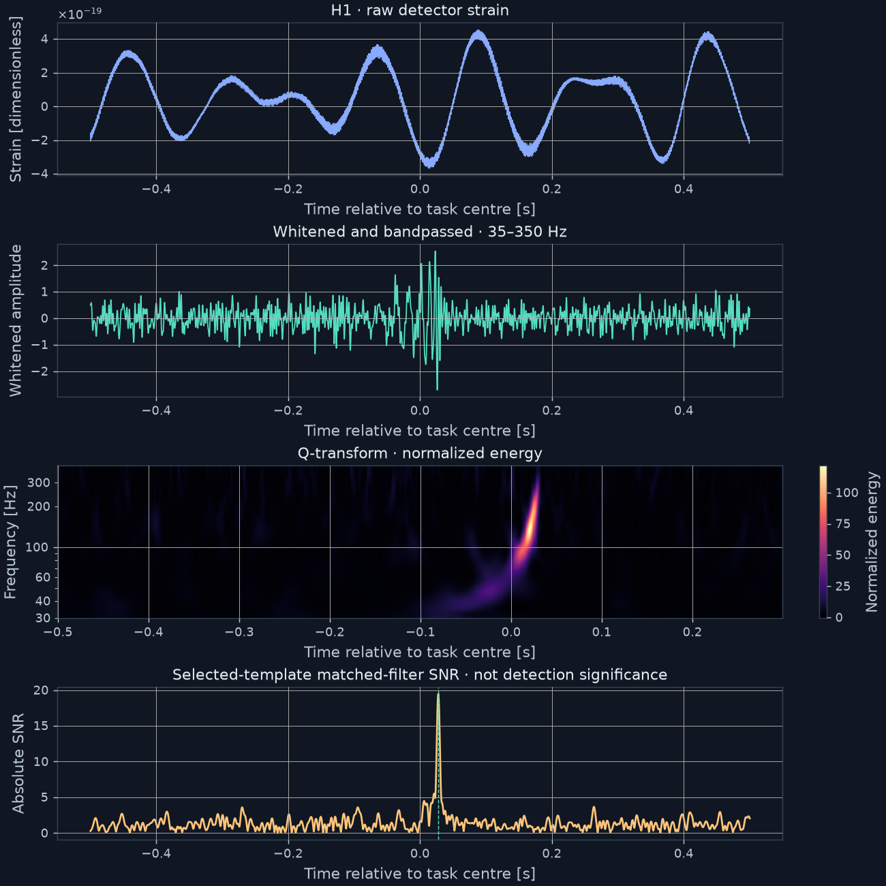

# Rediscover

**Find a gravitational-wave signal in real detector data. Show the evidence.**

A CPU-only physics workbench and MCP server for students, educators, curious builders and agent developers. Download public LIGO strain, run a numerical template search, inspect the chirp, and export a source-linked report. No phone, hardware, GPU or AI subscription required for the core workflow.

[Example results](examples/verified/RESULTS.md) · [Usage](docs/USAGE.md) · [Physics](docs/PHYSICS.md) · [Security](SECURITY.md) · [Releases](https://github.com/shyamolkonwar/rediscover/releases)



## Run it

Requires **Python 3.12 or 3.13**. Linux/Python 3.12 is the release-verified platform. macOS and Windows are not yet validated; use Linux or WSL2 if numerical dependencies fail to install. The scientific stack is substantial; installation time depends on wheel availability and your connection.

Install [uv](https://docs.astral.sh/uv/getting-started/installation/), then:

```sh
uv tool install --python 3.12 'git+https://github.com/shyamolkonwar/rediscover.git@v0.1.0'
rediscover doctor
rediscover run GW150914-v3 --catalog
```

Or install the wheel from the [GitHub release](https://github.com/shyamolkonwar/rediscover/releases/tag/v0.1.0) inside a virtual environment. The distribution is named `rediscover-physics`; the existing PyPI project `rediscover` is unrelated. **This release is distributed through GitHub, not PyPI.**

Open the HTML path printed by the command. It contains the real plots, measurements, source URLs, input hashes, numerical settings and limitations. Plots are embedded, so the HTML works offline. Keep the run directory if you want the full evidence bundle.

### What you will see

For GW150914, the release run returned:

| Detector | Peak matched-filter SNR | Detector-frame chirp mass [solar masses] |
|---|---:|---:|
| Hanford H1 | 19.440 | 32.559 |
| Livingston L1 | 14.023 | 30.469 |

The difference between independently fitted detector peak times was about **5.86 ms**. These are finite-bank reproduction results, **not** a new discovery, significance measurement, precision sky localization, or Bayesian mass inference. The mismatch between detector mass estimates illustrates the limits of a coarse bank.

## Use it from an AI agent

After installation, add this stdio MCP server to your MCP host:

```json
{
  "mcpServers": {
    "rediscover": {
      "command": "rediscover-mcp",
      "args": [],
      "env": {"OPENBLAS_NUM_THREADS": "2", "OMP_NUM_THREADS": "2"}
    }
  }
}
```

If your host does not inherit your shell PATH, use the absolute installed executable path. An [example configuration](examples/mcp-config.json) is included. No Azure key is needed for MCP: your existing agent supplies the model.

Ask:

> Analyze GW150914-v3 with Rediscover. Check both detectors' data quality, run the matched filter, explain the mass estimates and timing difference, and make a report. Cite tool evidence; do not quote memorized numbers as measurements.

The tools handle data access, quality checks, bounded numerical analysis, catalog references, reports and artifact verification. No arbitrary shell or generated-code execution is exposed.

## What makes this different from a chat demo?

- **Real inputs:** official GWOSC HDF5, source/version recorded, checksummed downloads. Failed downloads stay failed.
- **Numerical authority:** PyCBC performs PSD-weighted IMRPhenomD matched filtering. The model does not calculate the result in prose.
- **Inspectable evidence:** immutable run inputs, per-tool evidence IDs, library versions, settings and artifact checksums.
- **Bounded agent harness:** optional Responses-compatible model integration with call/output budgets and validation of final numbers against evidence.
- **Opaque test tasks:** synthetic physical waveforms injected into actual detector strain, plus a no-added-signal control. The agent cannot read injection truth through its tools.
- **No compulsory AI:** the entire scientific workflow works from the CLI.

## Check an agent

Use your own Azure or Responses-compatible provider. Set `REDISCOVER_API_BASE` and `REDISCOVER_API_KEY` using your environment manager; never put credentials in an issue or commit. Azure bases end in `/openai/v1`.

```sh
rediscover fetch GW150914-v3
rediscover agent RUN_ID --model YOUR_DEPLOYMENT
rediscover report RUN_ID

# Numerical baseline, no model bill:
rediscover bench

# Explicit paid model evaluation:
rediscover bench --model YOUR_DEPLOYMENT
```

The built-in model runner shares the same application layer as MCP; it uses Responses function tools. The MCP transport is independently tested over stdio.

The checked-in release evidence includes actual Azure runs with **gpt-6-sol and gpt-5.5**, not synthetic API responses. Each completed all six demonstration tasks with grounded final fields. Both scored the same as the deterministic baseline. **This is not evidence that one model is better, or that agents can independently discover gravitational waves.** Read the [results and rubric correction](examples/verified/RESULTS.md).

## Scientific scope

The default bank searches nonspinning component masses from 20 to 50 solar masses. Only event versions exposing short 32-second, 4-kHz H1/L1 strain pairs are supported. It is not a general neutron-star, high-spin or full-catalog search pipeline.

Important limits:

- Peak SNR is not a false-alarm probability. There is no calibrated background study or chi-square glitch veto.
- Masses are **detector-frame** bank points, not source-frame masses or posterior intervals.
- The search is centered on a supplied event time; it is not a blind discovery.
- Short-segment PSD estimates can contain the signal. In the opaque tasks the known event remains outside the search window in the same real segment; this is disclosed.
- A noise peak still has a best-matching template. Its masses must not be interpreted as a measured binary.
- Checksums detect accidental modification; they do not authenticate against someone who controls the machine.

See [the numerical method](docs/PHYSICS.md) for normalization, padding, data-quality boundaries and tests.

## Develop and contribute

```sh
git clone https://github.com/shyamolkonwar/rediscover.git
cd rediscover
uv sync --frozen --extra dev
uv run pytest -q
uv run ruff check src tests
uv build
```

The offline suite includes numerical positive/negative controls, malformed input, model-output rejection, concurrent evidence writes and a real MCP subprocess. Two additional real-data tests run when `REDISCOVER_REAL_DATA` points to the documented official fixtures. See [CONTRIBUTING.md](CONTRIBUTING.md).

## Attribution

Built on [GWOSC](https://gwosc.org/), [PyCBC](https://pycbc.org/), [LALSuite](https://lscsoft.docs.ligo.org/lalsuite/), [GWPy](https://gwpy.github.io/) and the [MCP Python SDK](https://github.com/modelcontextprotocol/python-sdk).

Use of the underlying data must follow [GWOSC attribution guidance](https://gwosc.org/acknowledgement/). This project is not affiliated with or endorsed by LIGO, Virgo, KAGRA or the named model providers. Code: [MIT](LICENSE). Public-data sources and hashes accompany each generated analysis.
